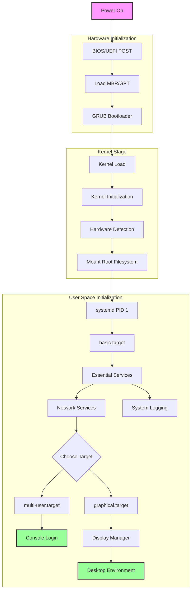

# Linux Boot Process

The Linux boot process is a sequence that transforms the computer from a powered-off state to a fully functional operating system

1. Power On & BIOS/UEFI Stage

- When you press the power button, the computer's BIOS (Basic Input/Output System) or UEFI (Unified Extensible Firmware Interface) initializes. 
- This firmware performs the Power-On Self-Test (POST), checking essential hardware components like memory, disk drives, and keyboard. 
- Think of this as the computer's morning routine – checking if everything is in working order before starting the day.

2. Boot Loader Stage (GRUB2)

- After the initial checks, the BIOS/UEFI looks for a bootable device according to the boot order configuration. 
- When it finds one, it loads the boot loader, typically GRUB2 (GRand Unified Bootloader version 2). 
- GRUB2 presents a menu allowing you to choose between different operating systems or kernel versions Even if you don't see this menu, it's still working behind the scenes.

3. Kernel Initialization

- When the kernel starts loading, it first decompresses itself into memory. 
- The kernel then initializes hardware devices, memory management systems, and mounts the root file system. 
- During this stage, the kernel sets up crucial systems like the process scheduler and memory manager. - This is similar to an orchestra conductor taking their place and ensuring all instruments are ready to play.

4. Init System (systemd)

- Modern Linux systems use `systemd` as their initialization system. 
- `systemd` becomes the first process (PID 1) and starts managing the entire user space start-up. 
- It reads its configuration from `/etc/systemd/system`, determining which services should start in which order. `systemd` uses parallel processing to start multiple services simultaneously, significantly speeding up the boot process.

5. Runlevel/Target Implementation

systemd implements different targets (equivalent to traditional runlevels) that represent different system states. For example:
- `poweroff.target` (runlevel 0): System shutdown
- `rescue.target` (runlevel 1): Single user mode
- `multi-user.target` (runlevel 3): Multi-user mode without GUI
- `graphical.target` (runlevel 5): Multi-user mode with GUI

6. Service Initialization

Finally, various system services start according to their dependencies and configuration. These might include:

- Network services
- System logging
- Display manager (for GUI)
- User applications configured to start at boot

